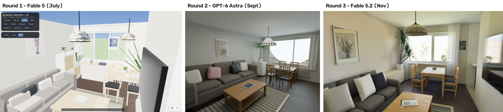
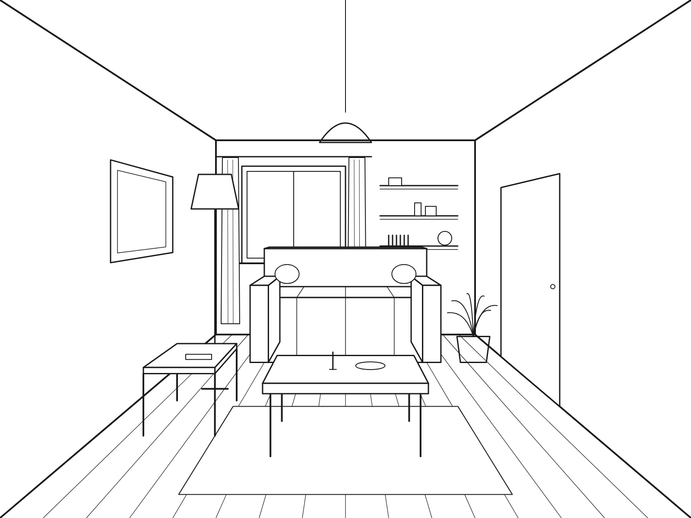
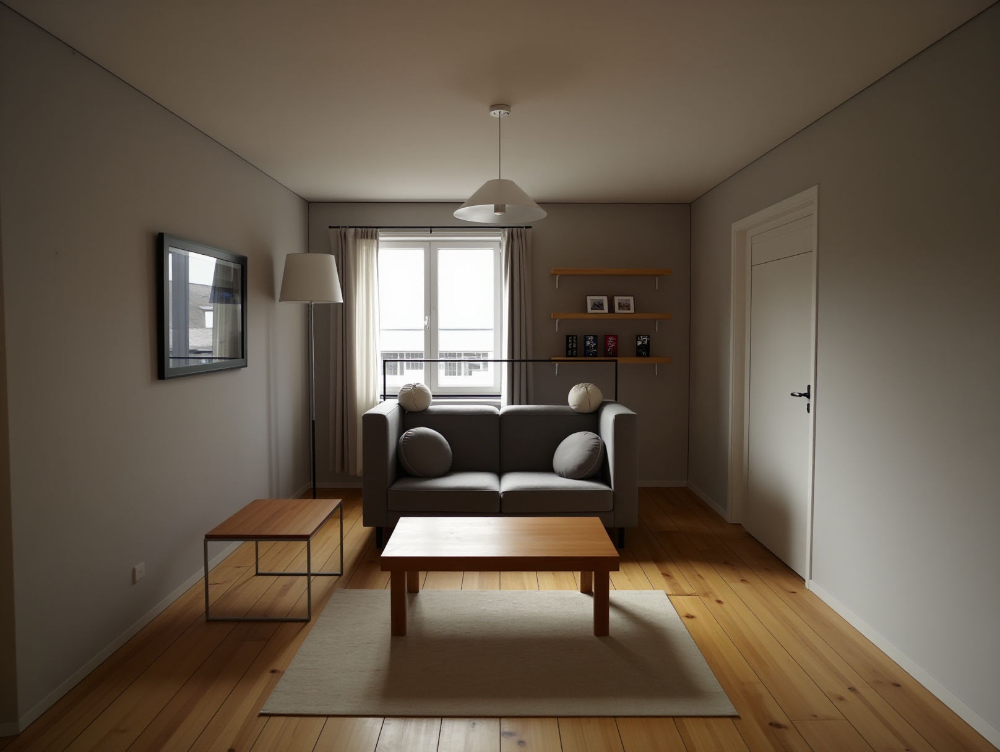

# AI learning log

<!-- Draft written with Claude. Karoliina: make it sound like you, then delete this line. -->

Hi, I'm Karoliina. This is where I keep what I make, test and learn in AI.

I started learning AI this summer, when I got into AI video creation and made my first 3D models, and got serious about it in November. My background is project management and web analytics, so I like to test things properly and write down what I find.

**How I work:** I study with Claude. I ask it to explain the concepts, to make me guess the result before every test, and to explain why things happened. I run the tests, write down my guesses and judge the results myself. Each experiment says exactly who did what.

---

## Creative work

**[Experiment 0 — Bootcamp work](experiment-00.md)**
My creations from the AI Video Bootcamp and The Reel Studio courses: a character made from my own face, a realistic tech influencer and a product ad.

**[Experiment 4 — One apartment, three AI models](experiment-04.md)**
I rebuilt my parents' apartment in 3D three times between July and November, each time with a newer AI model, to see how fast the models improve. Try [Round 1](https://claude.ai/artifact/G5kgYgDm56qwGTLdSSsH7w) and [Round 2](https://claude.ai/artifact/DgagVXnPVq53nVFKwBR2Qf) in your browser.

---

## Interior rendering: from sketch to photo

I wanted to understand how AI interior renderers work, so I started with MyArchitectAI, then rebuilt a similar process myself in ComfyUI. What I wanted to find out: can AI make my sketch look like a real photo and still keep everything where I drew it?

- **[Experiment 1 — MyArchitectAI](experiment-01.md):** floor edits on a photo of my living room, and how a style changes a sketch render
- **[Experiment 2 — ComfyUI basics](experiment-02.md):** my first time in ComfyUI, learning what the prompt and the seed do
- **[Experiment 3 — ControlNet](experiment-03.md):** giving the model my sketch as an image, and comparing different guides

| My sketch | My best render so far (Experiment 3) |
| --- | --- |
|  |  |

**What I found so far:**
1. **A style makes it prettier but moves things.** In MyArchitectAI, about 74% of my sketch lines stayed in place without a style, and about 53% with one.
2. **The prompt decides *what*, the seed decides *where*.** With a short prompt, a new seed gives a completely different room.
3. **Two guides together work better than one.** Canny kept my lines but looked fake, depth looked real but lost the windows. Both together gave the best balance.
4. My most accurate render (95%) looked the least real. So I don't trust the number alone. I always look at the picture myself and try more than one seed.

<b>How I measure geometry</b>

I put my sketch lines on top of the render and count how many of them still have an edge nearby (within about 8 pixels, less than 1% of the image width). More lines kept = the AI moved less of my room.

- It only makes sense when the render is made *from* my sketch, so the camera stays the same.
- It's not perfect: a render that just paints my lines on top scores high, and wooden floor planks can match by accident. That's why I always look with my own eyes too.
- Changing only the seed moves the score by about 6 points, so smaller differences can be just random.

The script is [measure_geometry.py](measure_geometry.py). Claude wrote it with me, and I ran it myself in Google Colab to check that it gives the same numbers as in my logs.

---

## Tools I've used

Midjourney · Nano Banana · Promptwise · Higgsfield · Runway · MyArchitectAI · ComfyUI · Claude · Claude Code · ChatGPT · Codex · Google Colab

## Next

- Test MLSD, a ComfyUI guide that only follows straight lines and is made for architecture.
- Use a better input for rendering: a screenshot from a 3D model, like architects would give a renderer.
- Add Round 3 of the 3D apartment as an explorable model.
