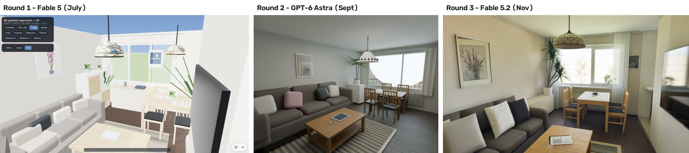
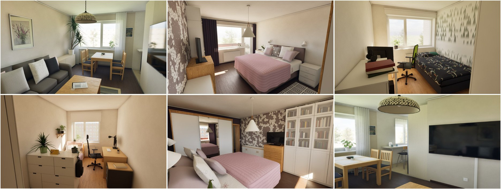

# Experiment 4 — Nov 2026

**Goal:** After discovering Fable 5 easily creates 3d models, I wanted to test it out. I took one real apartment (my parents' home), created a 3d model of it and rebuilt it two times, each time with a newer model. The first result was quite impressive and fun to create so I want to keep doing the same with all new models. I want to see how much better do AI models get at turning a real apartment into a 3D model (sometimes in just a few months).

**Input every time:** the floor plan (very basic) and around 25 photos of the rooms. I left the address and the floor plan out of this page on purpose.

I got guidance on this from my brother who is a tech engineer. Round 3 used a 3D toolkit my brother made by having Claude Code search X posts and GitHub repos and put the best tools together.

---

### Try it yourself

- **[Round 1 in 3D (Fable 5, July)](https://claude.ai/artifact/G5kgYgDm56qwGTLdSSsH7w)**: drag to look around, room buttons on the left
- **[Round 2 in 3D (GPT-6 Astra, September)](https://claude.ai/artifact/DgagVXnPVq53nVFKwBR2Qf)**: walk around with W/A/S/D or the arrow buttons
- Round 3 in 3D: coming soon. It runs in Unreal Engine, so for now there are pictures below.

---

### Same living room, three rounds

| | Round 1 | Round 2 | Round 3 |
|---|---|---|---|
| **When** | July 2026 | September 2026 | November 2026 |
| **Model** | Claude Fable 5 | GPT-6 Astra | Claude Fable 5.2 |
| **How** | Claude Code, simple prompt | Codex + a more specific prompt, also asking for blender | Claude Code + a strong prompt (including my brother's toolkit) |
| **What I saw** | right layout, but looks like a video game | massive step towards realism, but I noticed many random things and little mistakes | another level, the "wow" moment |

**Round 1:** the layout is right in all of the rooms. But everything is flat colours and awkward shapes, some unrecognisable details.

**Round 2:** going from Round 1 to 2 was a massive step towards realism. Real materials and light bouncing off the walls. I also noticed some random things (things going through walls, flying etc).

**Round 3:** another level. Soft light, a real view outside, the wallpapers look like the real ones and many other little details, it even wrote the right month in the calendar and didn't miss small surprising details.

### Prompts I used

Copied exactly as I typed them.

**Round 1 (Claude Code, Fable 5):**
> here are images and a floor plan of an apartment please create a 3d model for me.

**Round 2 (Codex, GPT-6 Astra):**
> using blender mcp build a beautiful visual 3d model of this home  and make it hyperrealsitic and accurate.  jpg. then host it on some url so i could fly and move around the render. make it first person view.

**Round 3 (Claude Code, Fable 5.2):**
> please create a hyperrealistic 3D model of this home. Look at the files and understand the struckture of this home. Please use ../../3d toolkit for building it -  please use blender to model it and use unreal engine to make it real. Ensure to do proper AAA tier modelling - normal maps, lighting etc. Ensure the model has both fly around and first person view mode. no need for any clicking between rooms, just an exploration tool.

---

### What I learned

- **It's not only the model.** Each round I changed two main things at once: the model and the prompt. I can say the whole setup got much better but it's also very important to make a strong prompt and to use tools. With the new models and updates coming out, it takes time until people discover their power. A good tip from my brother: it's good to keep an eye on X, the best way to learn about AI and what other people do.

  Looking back, the prompt was probably the biggest update, and Round 2 could have been better with a stronger prompt too. As my brother put it: over time you push the boundaries. When Fable 5 came out, it was amazing that it could do 3D at all, so we didn't even think to try Blender and Unreal.
- **What is new and cool today, might not be relevant tomorrow.** The way the first model was built is very outdated today. Same goes with most things with AI.
- **The layout was right from the start.** Even Round 1 put the furniture in the right places. The big jumps were in realism, big thanks to blender and unreal.

### What I'd still fix

- The view outside the windows is generic. I want to try to use Google Maps / street view so it shows the real surroundings.
- More accurate details: clothes, the things my parents actually have around.
- Some wallpapers to be even more accurate.

### Next I'd try

- Get Round 3 working as a 3D page too, so all three rounds can be explored in the browser.
- Give my Round 3 prompt to the older models (Fable 5 and GPT-6 Astra), to see how much of the improvement came from the prompt and how much from the newer model.
- Use a screenshot from one of my 3D models as the input in my Experiment 3 setup, because that's closer to what architects actually use, and see if the room stays accurate.

[← Back to the front page](README.md)
